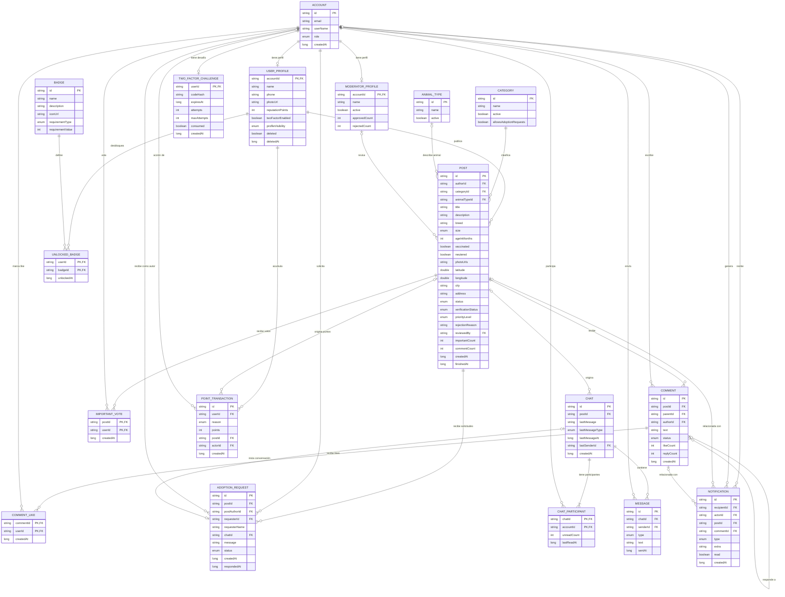

# Diagrama de datos del dominio

Diagrama lógico basado en los modelos de `domain/model`. Representa las entidades y sus relaciones; no implica que la aplicación ya use una base de datos relacional. Actualmente, los repositorios enlazados por Hilt son implementaciones en memoria.

## Correspondencia con los modelos

- `Location` y `Verification` se representan como campos embebidos en `USER_PROFILE` o `POST`, no como entidades independientes.
- `Reputation` se representa parcialmente en `USER_PROFILE` (`points`) y parcialmente en `UNLOCKED_BADGE` y `POINT_TRANSACTION`.
- `Chat.participantIds`, `unreadCounts` y `lastReadAt` son mapas/listas dentro del modelo actual. `CHAT_PARTICIPANT` es su representación relacional lógica; no es un modelo Kotlin independiente.
- `Account` está compuesta dentro de `User` y `Moderator`. Se muestra separada para aclarar su relación conceptual con los perfiles y con otras entidades.
- `Credentials` no debe persistirse. `TwoFactorChallenge` describe datos temporales y sensibles; su código debe guardarse como hash.
- `PublicProfile`, `UserSummary`, `PostFilter`, `PostStats` y `AwardResult` son modelos de presentación/consulta o resultados, no entidades persistentes.
- `AccountDeletionFeedback` existe como modelo de entrada, pero la implementación en memoria actual lo descarta; no se muestra como tabla persistida.
- Los estados y valores enumerados (`UserRole`, `PostStatus`, `VerificationStatus`, `NotificationType`, etc.) se representan como `enum`; no son tablas.
- `photoUrls` se muestra como campo de lista simplificado. En una base relacional normalizada podría separarse en una tabla de imágenes.
